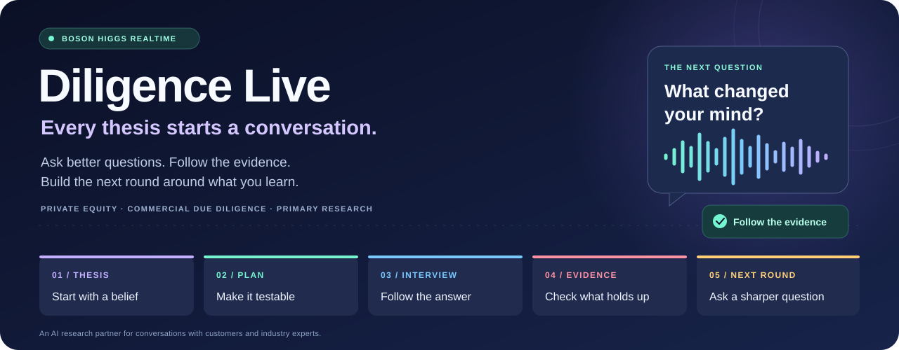
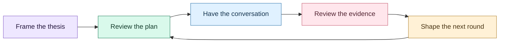

<p align="center">
  
</p>

<p align="center">
  <strong>An AI research partner for investment teams testing their assumptions through real conversations.</strong>
</p>

<p align="center">
  <a href="#the-story">The story</a> ·
  <a href="#try-the-demo">Demo walkthrough</a> ·
  <a href="#run-it-locally">Run locally</a> ·
  <a href="docs/architecture/README.md">Architecture</a> ·
  <a href="docs/architecture/gallery.html">Chart gallery</a>
</p>

## The story

Every investment thesis begins with a belief.

> *Customers will stay. Pricing will hold. The market will grow.*

Those beliefs deserve good questions. The answers live with the customers who buy the product, the operators who run the business, and the experts who know the market.

**Diligence Live helps private equity teams and consultants bring those conversations into their research.** Start with an investment thesis, shape an interview plan, and let an AI interviewer ask customers and industry experts about the assumptions that matter. Follow the transcript as the conversation unfolds. Review the evidence, see where people disagree, and decide what to investigate next.

A good answer can change the next question. A research round should leave you with a clearer picture of what holds up and what still needs work.

## From belief to evidence

| Chapter | What happens |
| --- | --- |
| 🟣 **01 · Frame the thesis** | Enter the company and the assumptions you want to test. |
| 🟢 **02 · Make a plan** | Select contacts, review hypotheses, and approve tailored interview questions. |
| 🔵 **03 · Start the conversation** | A participant opens an interview link and speaks with the AI interviewer. Upcoming questions adapt as answers arrive. |
| 🟠 **04 · Follow the evidence** | Compare completed transcripts against the thesis, with supporting quotes, conflicting perspectives, and research gaps. |
| 🟡 **05 · Ask what comes next** | Review a proposed next round: sharper hypotheses, people to speak to, and questions worth asking. |



### A conversation with a purpose

**Boson Higgs Realtime** carries the voice conversation and transcription. An optional **Higgs Avatar**, delivered through **LiveKit**, gives the interviewer a face. **Claude** revises pending questions as people answer, while **OpenAI** writes opening questions and assesses the completed interview evidence.

The consultant follows transcripts and question changes from a separate dashboard. The participant's browser owns the microphone and call. Findings connect the thesis to quotes checked against the submitted transcripts, and suggest where further research would help.

## Try the demo

Once the backend and dashboard are running:

1. **Create a diligence project.** The new-project form starts with an Oakville veterinary-clinic example; replace it with your own company and thesis if you prefer.
2. **Choose who to interview.** Add your own contacts or explore the demo expert directories.
3. **Review the Research Plan.** Check the hypotheses, audience, and opening questions before approving.
4. **Send the interview.** Open or share the participant link. The participant clicks **Start interview** and grants microphone access.
5. **Watch Live Research.** Follow the transcript and changing question list as the interview unfolds.
6. **Open Findings.** Review supported, contradicted, mixed, or insufficient evidence, inspect the quotes, and use the research gaps to plan another round.

**Want to explore the design first?** [Browse the eight architecture charts](docs/architecture/README.md#reusable-diagrams). For the interactive viewer, open `docs/architecture/gallery.html` locally after cloning; GitHub's file view displays its HTML source.

## Run it locally

Use **Node.js 22** (the root CI version), **Bun** for the dashboard's committed lockfile, and a browser with a microphone.

### 1. Install the backend and debug app

From the repository root:

```bash
npm ci
cp .env.example .env
```

Fill in the relevant values in your local, gitignored `.env`. The [example configuration](.env.example) lists the available settings.

| Configuration | Powers |
| --- | --- |
| `BOSON_API_KEY` or `BOSON_API_KEY_FILE` | Higgs Realtime voice sessions |
| `OPENAI_API_KEY` | Opening questions, thesis assessment, and next-round planning |
| `ANTHROPIC_API_KEY` | Adaptive interview questions |
| `LIVEKIT_URL`, `LIVEKIT_API_KEY`, `LIVEKIT_API_SECRET` | Optional avatar transport |
| `OPENAI_MODEL` | Optional override for the model selected by the backend |

### 2. Start the backend

```bash
npm run dev
```

This starts the **Express API on `http://localhost:3000`** and the original **voice/debug app on `http://localhost:5173`**. Keep it running while using the dashboard.

### 3. Start Diligence Live

In a second terminal:

```bash
cd frontend
bun install --frozen-lockfile
bun run dev
```

Open the **dashboard URL printed in that terminal**. Its `/api` requests are forwarded to the backend on port 3000. The dashboard port comes from its Vite configuration wrapper.

Restart the backend after changing `.env`. Voice/model sessions use the API accounts configured by those keys.

## Built with

| Layer | Ingredients |
| --- | --- |
| Research workspace | React 19, TypeScript, TanStack Start / Router, Tailwind CSS, Radix UI |
| Voice engine | Boson Higgs Realtime, browser WebSocket, Web Audio, AudioWorklet |
| Optional avatar | Boson Higgs Avatar and LiveKit |
| Research intelligence | OpenAI for opening questions and evidence analysis; Claude Haiku for question revisions |
| API | Node.js, Express, native `fetch`, server-side provider credentials |
| Local project state | React context and browser localStorage |
| Checks | Vitest, Testing Library, TypeScript, GitHub Actions |

The original debug app is a separate React 18 / Vite application. Both browser experiences share the voice core in `src/`. The Pipecat and LiveKit Agents examples are independent Python tutorial tracks.

## Explore the architecture

| Take a look inside | Where to go |
| --- | --- |
| **The complete reference** | [Architecture index](docs/architecture/README.md) |
| **The interactive gallery** | [Gallery HTML](docs/architecture/gallery.html) — open locally for zoom and source links |
| **System boundaries and domain model** | [Architecture](docs/architecture/architecture.md) |
| **The path from audio to evidence** | [Data flows](docs/architecture/data-flows.md) |
| **Dependencies, APIs, and storage** | [Tech stack](docs/architecture/tech-stack.md) |
| **Known gaps and follow-up work** | [Architecture audit](docs/architecture/audit.md) |
| **What was actually checked** | [Verification record](docs/architecture/verification.md) |

The architecture reference records its audited source SHA. Later application changes may go beyond that snapshot.

## Development checks

From the repository root:

```bash
npm test
npm run typecheck
npm run build
```

For the dashboard:

```bash
cd frontend
bun run test
bun run build
```

For provider diagnostics, `npm run check:openai` checks the configured OpenAI access and makes a small live request. `npm run probe` opens a live Higgs session and prints its protocol events; see the [probe guide](docs/how-to-use.md#the-probe). These commands use live APIs.

## The original tutorial

This project builds on the Higgs Realtime tutorial included in the repository. The learning path is still here for developers who want to understand the voice engine from the first token request onward.

<details>
<summary><strong>📚 Open the eight-chapter voice-agent learning path</strong></summary>

Comfort with JavaScript/TypeScript, React, and `fetch` is enough to begin. Audio and WebSocket concepts are introduced as the tutorial uses them.

| Chapter | What you build |
| --- | --- |
| [0 · Keep the key server-side](docs/part-0.md) | A token endpoint for short-lived browser credentials |
| [1 · Hear the first reply](docs/part-1.md) | A WebSocket connection and typed-to-spoken exchange |
| [2 · Start talking](docs/part-2.md) | Microphone capture, turn detection, and interruptions |
| [3 · Put the conversation in order](docs/part-3.md) | A transcript reducer for asynchronous events |
| [4 · Give the model a tool](docs/part-4.md) | Tool calling with a bundled dummy search index |
| [5 · Shape the voice](docs/part-5.md) | A testable system-prompt structure |
| [6 · Try Pipecat](docs/part-6.md) | An independent Python voice agent and browser playground |
| [7 · Try LiveKit Agents](docs/part-7.md) | An independent Python worker with the Agents Playground |

The Python tracks need Python **3.11–3.13** and `uv`; Part 7 also uses an external playground and its own LiveKit setup. Follow the chapter-specific setup before starting either track.

The root debug app exposes editable session instructions, VAD/transcription events, tool activity, and protocol logs. Its `web_search` tool reads a bundled JSON fixture rather than a real search engine.

[Original usage guide](docs/how-to-use.md) · [Higgs Realtime documentation](https://docs.boson.ai/models/higgs-realtime/overview)

</details>

## Prototype boundaries

This is a hackathon prototype with real voice/model integrations. Project data is saved in the consultant browser's localStorage; backend interview sessions live in process memory and disappear when that process restarts. Expert-network connections are demo directories, and the application does not dial phone numbers or deliver invitations by email/SMS.

Quote checks establish textual inclusion in a submitted transcript. Evidence quality and investment conclusions still need human review. The [audit](docs/architecture/audit.md) documents authentication, persistence, synchronization, media-lifecycle, and type-checking work that remains.

## License

[Apache License 2.0](LICENSE).
