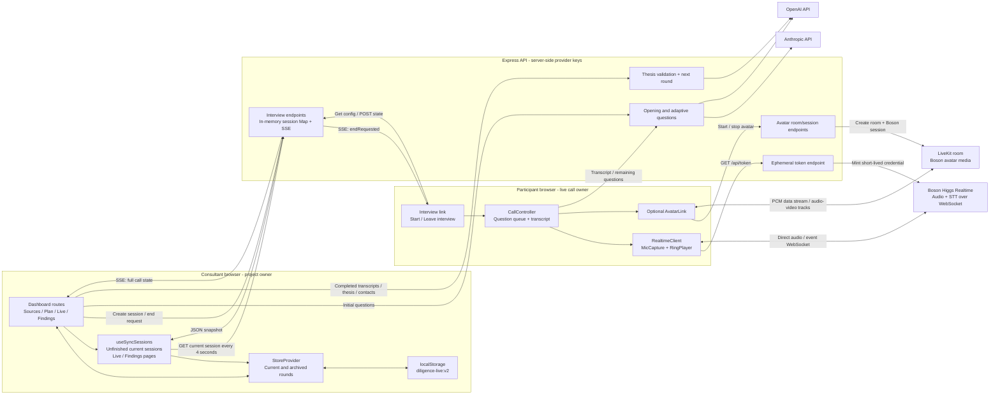
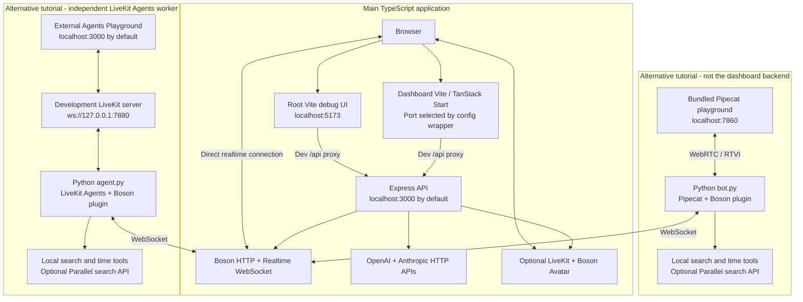
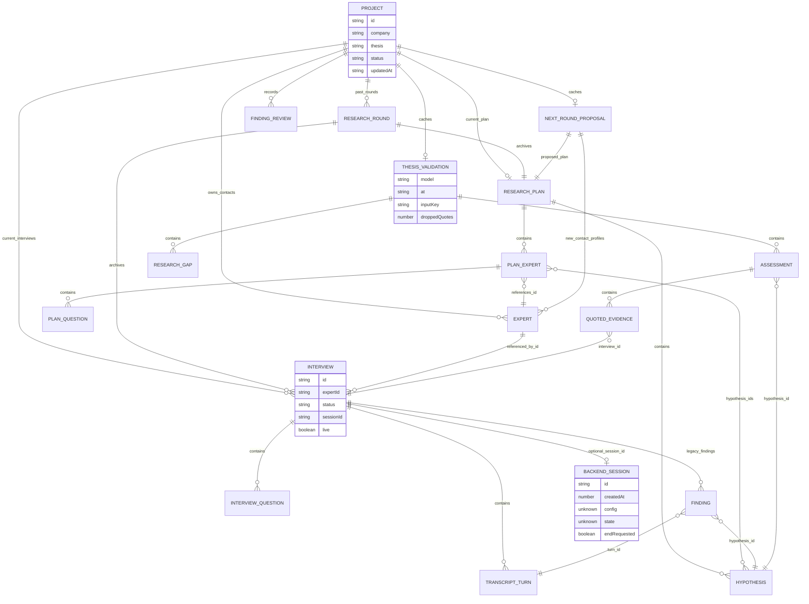

# System architecture

Snapshot: `f212a7046a2a4b66b4967c57d0528c4016737bf2`, 2026-10-24. These diagrams show implemented boundaries. Suggested future changes belong in [audit.md](audit.md).

## Main application

[Editable Mermaid source](diagrams/02-system-architecture.mmd) · [SVG export](diagrams/02-system-architecture.svg)

The consultant browser owns the project record. It prepares research, invites participants, subscribes to live session snapshots while an interview detail is open, and saves transcripts locally. Live Research and Findings also poll unfinished current-round sessions immediately and every four seconds, recovering state/completion while the detail sheet is closed. This poller operates only while one of those pages is mounted and does not synchronize archived rounds. The participant browser owns the active call: microphone permissions, audio capture, Higgs WebSocket, adaptive question queue and avatar playback. The Express process brokers provider credentials/HTTP operations and relays call state; it is not the realtime audio relay.

The UI roles are not authenticated security roles. The session ID currently grants the same caller access to read config, replace state, subscribe and request termination. The config includes the investment thesis through the call goal. See findings A01-A02 before sharing this topology outside a controlled demo.

Relevant entry points:

| Responsibility | Source |
| --- | --- |
| Project store and persistence | [frontend/src/lib/store.tsx](../../frontend/src/lib/store.tsx) |
| Project routes | [frontend/src/routes](../../frontend/src/routes) |
| Consultant session sender/watcher | [frontend/src/components/live-call.tsx](../../frontend/src/components/live-call.tsx#L110) |
| Background current-session synchronization | [useSyncSessions](../../frontend/src/components/live-call.tsx#L356) |
| Participant call owner | [frontend/src/routes/interview.$sessionId.tsx](../../frontend/src/routes/interview.$sessionId.tsx#L34) |
| UI-independent interview orchestration | [src/call/CallController.ts](../../src/call/CallController.ts) |
| WebSocket/protocol orchestration | [src/realtime/RealtimeClient.ts](../../src/realtime/RealtimeClient.ts) |
| API and state relay | [server/index.ts](../../server/index.ts), [server/interviews.ts](../../server/interviews.ts) |
| Original debug UI | [src/App.tsx](../../src/App.tsx) |

## Runtime topology

[Editable Mermaid source](diagrams/07-runtime-topology.mmd) · [SVG export](diagrams/07-runtime-topology.svg)

For the main TypeScript path, root `npm run dev` starts Express and the root Vite UI; the dashboard is started separately from `frontend/`. Both UI dev servers forward `/api` to Express at port 3000. The root debug UI explicitly selects port 5173. The dashboard port is supplied by its configuration wrapper and is not fixed in the checked-in configuration.

Pipecat and LiveKit Agents are alternative tutorial tracks. They run independent Python voice agents, execute their own tools, and use their own browser playgrounds. The Python LiveKit agent is not the process that animates the dashboard avatar. Both Python tool modules also load the repository's shared search fixture.

The external LiveKit Agents Playground defaults to port 3000, which conflicts with the Express default if both tracks are run at once. Treat the tracks as alternatives or assign distinct ports. See [Part 6](../part-6.md) and [Part 7](../part-7.md) for their operational setup.

Building the dashboard produces its TanStack/Nitro application. Building the root produces the Vite client; its server TypeScript project is configured `noEmit`. Neither build supplies a durable backend datastore or the missing production API routing described in A15.

## Logical data model

[Editable Mermaid source](diagrams/06-domain-model.mmd) · [SVG export](diagrams/06-domain-model.svg)

This is a logical model of TypeScript objects and ID references, not a database schema. Relationships express intended ownership, not enforced foreign keys. Source: [frontend/src/lib/types.ts](../../frontend/src/lib/types.ts).

The current round is represented by `project.plan` and `project.interviews`; past rounds are `{plan, interviews}` entries in `pastRounds`. `roundsOf`, `allInterviews` and `allHypotheses` consolidate reads ([mock-service.ts](../../frontend/src/lib/mock-service.ts#L30)). Round selection is view state, independent of this model.

Contacts are mutable project-level records. Interviews reference them by `expertId`, without an immutable participant snapshot. Generated validation evidence links an interview ID and quote, without a turn ID or stored audio timestamp. Stored legacy `Finding` objects do have a turn ID, and follow a different path from the real model assessment. These distinctions explain the attribution and report findings in the audit.

A backend session is a separate in-memory object. Its ID is copied into the local interview record; the server does not own or reconstruct the project aggregate. It keeps only the latest CallState rather than a durable sequence of state transitions.

## Architectural strengths to preserve

- Provider API keys stay server-side; browser realtime connections receive short-lived credentials.
- Audio/media handling is separated from the dashboard, allowing the root debug app to exercise the same protocol client.
- A dedicated transcript reducer handles item ordering and delayed STT, with offline replay tests.
- Question generation has an explicit template fallback; validation distinguishes mixed and insufficient evidence.
- Quote filtering rejects model quotes that cannot be found in the submitted interviewee text.
- Deterministic demo data and pinned dependency/fork resolutions support reproducible demonstrations.

The audit identifies where ownership and synchronization need strengthening around these existing boundaries.
