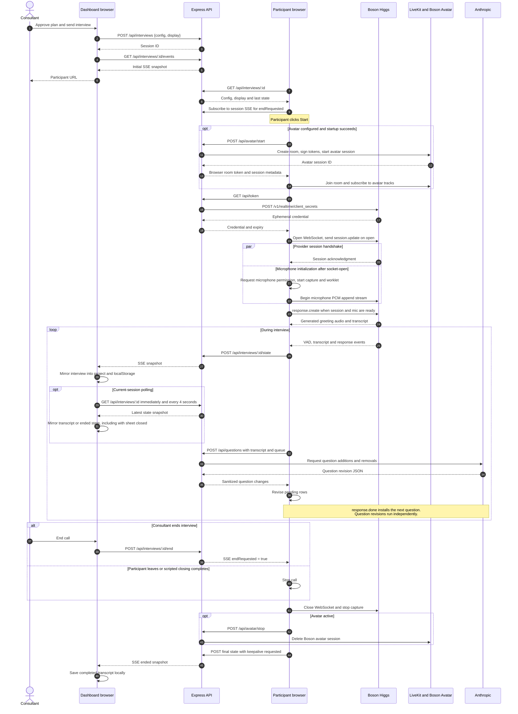
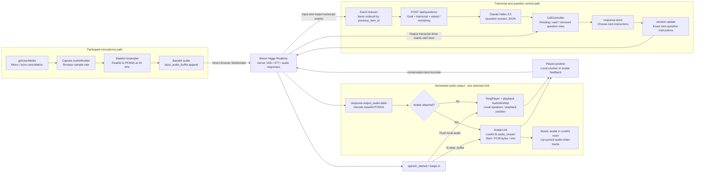
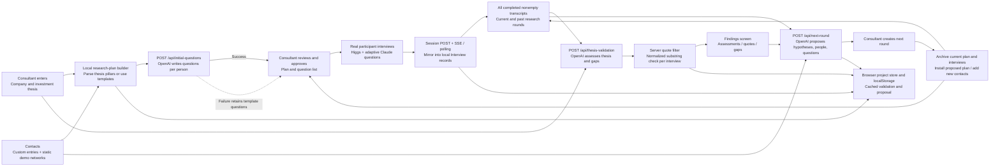
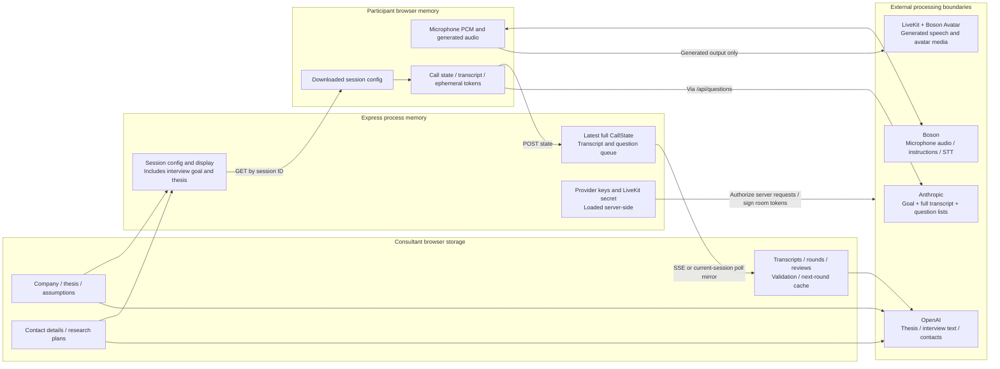

# Data flows

Snapshot: `f212a7046a2a4b66b4967c57d0528c4016737bf2`, 2026-10-24. Diagrams describe the normal implemented path; failure and race conditions are documented in [the audit](audit.md).

## Interview invitation, live monitoring and completion

[Editable Mermaid source](diagrams/03-interview-sequence.mmd) · [SVG export](diagrams/03-interview-sequence.svg)

The consultant creates the backend session before the participant starts. The participant URL retrieves a config containing greeting, goal, questions, audience, closing and optional avatar settings. No phone dialer or SMS/email delivery integration is present; the application creates/opens a browser interview link.

The participant batches state publication at roughly one request per 250 ms and attempts an immediate `keepalive` POST when ended. These are complete snapshots, not transcript deltas. The server broadcasts them to its subscribers, and the consultant mirrors them into the browser project store. The server heartbeat is every 15 seconds. A delivery attempt is not an acknowledgement of durable completion; there is no revision number, event log or server-persisted final transcript.

On Live Research and Findings, a separate poller immediately fetches unfinished current-round sessions and repeats every four seconds. It mirrors returned state when there is transcript text or the call has ended, allowing a call to finish while its detail sheet is closed. Polling stops on page unmount or once the local record is completed. It does not cover past rounds, and requests are not serialized if a previous polling pass is still waiting.

Sources: [consultant hook](../../frontend/src/components/live-call.tsx#L110), [participant publisher](../../frontend/src/routes/interview.$sessionId.tsx#L57), [session relay](../../server/interviews.ts#L38).

## Audio processing and adaptive questions

[Editable Mermaid source](diagrams/04-audio-and-adaptation.mmd) · [SVG export](diagrams/04-audio-and-adaptation.svg)

Microphone capture uses the browser-selected audio graph rate, batches approximately 100 ms frames, resamples to 24 kHz and sends mono signed little-endian PCM16 encoded as base64. Higgs receives these directly through the browser WebSocket. The application sends `server_vad` rather than explicit numeric VAD thresholds, and does not manually commit microphone buffers.

Generated audio uses one sink at a time: the local playback ring or AvatarLink. The local ring stores up to 12 seconds; overflow overwrites the oldest samples. The avatar path sends generated speech as LiveKit byte streams with topic `lk.audio_stream`, sample-rate/channel attributes, and utterance boundaries. The participant microphone is not published into that avatar room by AvatarLink.

Input transcription completion launches the Anthropic question revision request. Assistant `response.done` independently installs instructions for the next pending question. Those operations do not share an orchestration barrier, and a late revision does not immediately replace the instruction already loaded into Higgs. The diagram preserves that distinction rather than implying that every response waits for revised questions.

Sources: [capture](../../src/audio/capture.ts#L25), [resampler](../../src/audio/resample.ts), [session configuration](../../src/realtime/sessionConfig.ts#L63), [playback ring](../../src/audio/worklets/playback-processor.js), [avatar streaming](../../src/avatar/AvatarLink.ts#L253), [question orchestration](../../src/call/CallController.ts#L289).

### Interruption and call lifecycle

On server `speech_started`, the client flushes local audio or requests avatar `lk.clear_buffer`. If it obtains a positive played position, it sends `conversation.item.truncate`. It does not send `response.cancel`; stopping ongoing generation relies on provider VAD behavior. Avatar feedback can be delayed or unavailable.

The controller phases are `idle`, `starting`, `live` and `ended`. “Live” follows socket-open and microphone initialization; the client separately tracks whether the provider acknowledged the session. Normal scripted completion arms end-after-playback with a 15-second fallback. Manual stop closes realtime, stops capture and closes the avatar; disposal additionally closes local playback resources. Remote close and in-flight startup have cleanup gaps, so these phases should not be interpreted as proof of resource ownership having ended. See A06-A09.

Sources: [barge-in](../../src/realtime/RealtimeClient.ts#L565), [controller startup/stop](../../src/call/CallController.ts#L207), [closing completion](../../src/realtime/RealtimeClient.ts#L343).

## Research and successive rounds

[Editable Mermaid source](diagrams/05-research-data-flow.mmd) · [SVG export](diagrams/05-research-data-flow.svg)

Research planning starts locally: parse thesis pillars or select hypotheses from templates, then ask OpenAI for tailored opening questions for each selected person. The consultant approves the plan before local interviews are created.

For validation, the dashboard sends the company, full thesis, all hypotheses, and nonempty transcripts from completed interviews across rounds. Interview payloads include participant metadata, planned question status and speaker-labeled text. The server asks OpenAI for assessments and gaps, then filters quoted evidence by a normalized substring match against that interview's submitted interviewee turns. This verifies textual inclusion, not speaker identity, truth, contextual relevance or the correctness of a conclusion. Filtering all quotes currently leaves the model's assessment and confidence unchanged (A10).

Next-round planning sends the latest assessment/gaps, contact list and completed transcripts back to OpenAI. Already-asked questions are included to discourage repetition. Proposed new people are role profiles, not contacted or verified recruits. Creating the round archives the existing plan/interview array and installs a new unapproved plan. Active/invited interviews are not resolved before that archive operation (A05).

Sources: [opening questions](../../frontend/src/lib/initial-questions.ts), [validation payload/cache](../../frontend/src/lib/thesis-validation.ts), [server quote filter](../../server/validation.ts#L237), [already-asked context](../../server/validation.ts#L165), [next-round state transition](../../frontend/src/lib/next-round.ts#L139).

## Data ownership and external processing

[Editable Mermaid source](diagrams/08-data-ownership.mmd) · [SVG export](diagrams/08-data-ownership.svg)

| Boundary | Data crossing it | What remains local |
| --- | --- | --- |
| Consultant → session API → participant | Interview config/display, including thesis in the goal | Full project aggregate remains in consultant localStorage |
| Participant → Boson | Mic audio, instructions, generated conversation/tool messages | Local playback queues and UI state |
| Participant → Anthropic through Express | Interview goal, asked/remaining questions and entire current transcript | Provider key stays server-side |
| Consultant → OpenAI through Express | Thesis, hypotheses, interview text and relevant person/contact metadata | Project CRUD and review edits stay browser-local |
| Browser → LiveKit/Boson Avatar | Generated speech PCM; room/session credentials | AvatarLink does not publish participant mic audio into the room |
| Participant → Express → consultant | Full CallState snapshots, including transcript and question changes; SSE while detail is open and current-session polling on Live/Findings | Server has latest state only; consultant stores the local project copy |

The API trusts submitted state and transcripts. Quote matching therefore cannot establish that an interview actually occurred. Removing a local project does not delete an existing in-memory backend session; session IDs remain usable until eviction or process restart. External-provider retention and account settings were outside this code audit.
