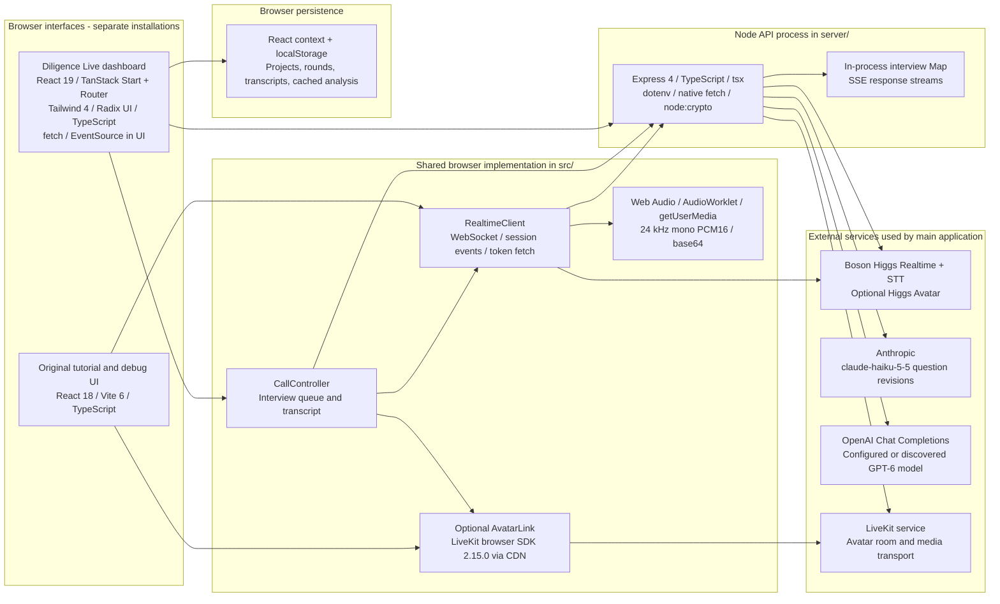

# Technology stack and implementation inventory

Snapshot: `9a82ca05d1b15d89209fe0dfd87f0e7d3995c88f`, 2026-10-24. See [audit findings](audit.md) for consequences of the boundaries described here.

## Technology map

[Editable Mermaid source](diagrams/01-tech-stack.mmd) · [SVG export](diagrams/01-tech-stack.svg)

## Applications and dependencies

Lockfile resolutions below describe the committed dependency graph, rather than every supported version or a production installation.

| Area | Stack and locked versions | Role and evidence |
| --- | --- | --- |
| Dashboard `frontend/` | React / React DOM 19.2.8; TanStack Router 1.170.41; Start 1.168.60; Vite 8.1.5; TypeScript 5.9.3 | Research interface, participant route and SSR shell; [manifest](../../frontend/package.json), [Bun lock](../../frontend/bun.lock), [router](../../frontend/src/router.tsx) |
| Dashboard UI | Tailwind Vite plugin 4.3.3; Radix UI components; Lucide; local UI wrappers | Styling and controls; [styles](../../frontend/src/styles.css), [components](../../frontend/src/components/ui-kit.tsx) |
| Dashboard build wrapper | `@lovable.dev/vite-tanstack-config` 2.26.5; Nitro `3.0.260603-beta`; Rolldown overridden to 1.2.1 | Supplies framework/Vite/build plugins; [Vite configuration](../../frontend/vite.config.ts), [manifest override](../../frontend/package.json#L16) |
| Root debug/tutorial app | React / React DOM 18.3.1; Vite 6.4.3; TypeScript 5.9.3 | Original voice-assistant playground and protocol/debug views; [entry](../../src/main.tsx), [App](../../src/App.tsx), [npm lock](../../package-lock.json) |
| Express API | Express 4.22.2; dotenv 16.6.1; tsx 4.23.11; native `fetch` and `node:crypto` | Provider requests, JWT signing, in-memory session relay; [server entry](../../server/index.ts) |
| Browser media | `getUserMedia`, Web Audio, AudioWorklet, browser WebSocket | Microphone processing and local playback; [capture](../../src/audio/capture.ts), [playback](../../src/audio/playback.ts) |
| Avatar browser SDK | `livekit-client@2.15.0`, loaded at runtime from unpkg | Avatar room, byte streams and media tracks; [AvatarLink](../../src/avatar/AvatarLink.ts#L18). This dependency is outside both package locks. |
| Root tests | Vitest 2.1.9 | Resampling/PCM, transcript reducer, bundled tool behavior; [tests](../../test) |
| Dashboard tests | Vitest 4.1.11, Testing Library, jsdom | Local helpers/simulation, round selection, route matching; [test configuration](../../frontend/vitest.config.ts), [tests](../../frontend/src/test) |
| Pipecat alternative | Python `>=3.11,<3.14`; `pipecat-ai` 1.12.0; Boson plugin from a pinned Git fork | Separate worker/playground tutorial; [manifest](../../pipecat/pyproject.toml), [uv lock](../../pipecat/uv.lock) |
| LiveKit Agents alternative | Python `>=3.11,<3.14`; agents and OpenAI/Boson plugins report 1.8.2 at a pinned fork commit | Separate worker plus external playground; [manifest](../../livekit/pyproject.toml), [uv lock](../../livekit/uv.lock) |

Root and dashboard are separate installations with different React, Vite and Vitest majors. There is no npm workspace linking them. The dashboard aliases `@higgs/*` to `../src/*`, so it consumes the shared root source during build ([tsconfig](../../frontend/tsconfig.json#L32)). The root debug app constructs `RealtimeClient` directly; the dashboard constructs `CallController`, which wraps that same client. Their interview orchestration is partly duplicated.

React Query is provided at the dashboard root, but the research operations inspected here use React context and direct `fetch` calls. A dependency appearing in the manifest does not establish its use at a particular boundary. For example, the API does not use the dashboard's Zod dependency to validate requests.

## Provider responsibilities

| Provider/path | Responsibility | Implementation |
| --- | --- | --- |
| Boson Higgs Realtime | Spoken conversation, VAD and input transcription; `higgs-realtime`, `higgs-stt-3.1`, English STT | [Session configuration](../../src/realtime/sessionConfig.ts#L63), [WebSocket client](../../src/realtime/RealtimeClient.ts#L21) |
| Boson client secrets | Mint a fresh browser credential; requested lifetime 600 seconds | [Token endpoint](../../server/index.ts#L163) |
| Boson Higgs Avatar + LiveKit | Optional animated interviewer; receives generated speech and publishes avatar media | [Server room/session setup](../../server/avatar.ts#L107), [browser link](../../src/avatar/AvatarLink.ts#L162) |
| Anthropic Messages API | Revise upcoming questions after input transcription; configured model `claude-haiku-5-5` | [Question endpoint](../../server/index.ts#L52) |
| OpenAI Chat Completions | Opening questions, thesis validation/research gaps, next-round proposal | [Initial questions](../../server/index.ts#L228), [validation and planning](../../server/validation.ts) |
| OpenAI model selection | Use `OPENAI_MODEL`, otherwise discover a preferred `gpt-6*` ID once per process | [Model resolver](../../server/validation.ts#L83) |

The API uses HTTP requests rather than Anthropic/OpenAI SDKs. LiveKit server tokens are HS256 JWTs signed with `node:crypto`; room creation calls LiveKit's Twirp HTTP endpoint directly ([server/avatar.ts](../../server/avatar.ts#L43)).

## Implemented versus simulated

| Capability | Current implementation |
| --- | --- |
| Projects, contacts, reviews, plans and rounds | Browser state persisted to localStorage; no project CRUD backend |
| GLG / AlphaSights / Third Bridge connections | Static demo directories and local connection flags; no network integration |
| Initial hypotheses and expert selection | Local thesis-pillar parsing or templates; generic plan considers up to three selected contacts |
| Opening questions | Real OpenAI request, with explicit local template fallback on failure |
| Voice interviews | Implemented live participant-side Boson connection and optional avatar |
| Automatic demo interviews | Simulation helpers remain; auto-running store simulation is disabled |
| Thesis findings and next-round recommendations | Implemented OpenAI requests based on completed transcripts |
| Printable report | Separate legacy route using local/mock findings; does not consume real model validation |
| Browser `web_search` tool | Searches the bundled `src/tools/searchIndex.json`; no actual web request |
| Python search/time tools | Separate worker-local tools; can optionally use Parallel search when configured |

Sources: [sources route](../../frontend/src/routes/projects.$projectId.sources.tsx#L55), [plan builder](../../frontend/src/lib/mock-service.ts#L240), [question fallback](../../frontend/src/lib/initial-questions.ts#L55), [disabled simulation](../../frontend/src/lib/store.tsx#L57), [report](../../frontend/src/routes/projects.$projectId_.report.tsx#L30), [browser search](../../src/tools/handlers.ts#L22), [Python tools](../../pipecat/tools.py).

## HTTP API inventory

All routes below belong to the Express process. Its global JSON parser permits request bodies up to 2 MB. The routes have no authentication, per-project authorization or rate-limit middleware in this snapshot.

| Method and route | Caller and data | Result / downstream |
| --- | --- | --- |
| `GET /api/health` | Operational caller | `{ok:true}`; process liveness only |
| `GET /api/token` | Browser voice client | Boson ephemeral credential and expiry |
| `POST /api/initial-questions` | Dashboard: company, thesis, person, hypotheses | OpenAI-generated opening questions/objectives/audience |
| `POST /api/questions` | Participant/debug app: goal, audience, asked/remaining questions, full transcript | Anthropic additions/removals, prompt and timing details |
| `POST /api/thesis-validation` | Dashboard: thesis, hypotheses, completed interview payloads | OpenAI assessments/gaps with server-filtered quotes |
| `POST /api/next-round` | Dashboard: thesis, prior assessments/gaps, contacts and transcripts | OpenAI-proposed hypotheses, people and questions |
| `POST /api/avatar/start` | Participant/debug app: optional avatar ID | Creates LiveKit room/tokens and Boson avatar session |
| `POST /api/avatar/stop` | Participant/debug app: avatar session ID | Deletes Boson avatar session |
| `POST /api/interviews` | Consultant: call config and display metadata | Random 16-hex-character session ID |
| `GET /api/interviews/:id` | Participant, or any caller with session ID | Config plus latest state/display/end flag |
| `POST /api/interviews/:id/state` | Participant: entire CallState | Replaces session state and broadcasts SSE snapshot |
| `POST /api/interviews/:id/end` | Consultant, or any caller with session ID | Sets end flag and broadcasts it |
| `GET /api/interviews/:id/events` | Both browser roles | Initial snapshot, subsequent full snapshots, 15-second heartbeat |

Sources: [server entry](../../server/index.ts#L44), [interview routes](../../server/interviews.ts#L43), [validation route](../../server/validation.ts#L203), [next-round route](../../server/validation.ts#L333).

## State and persistence

| Data | Owner / storage | Lifetime and constraints |
| --- | --- | --- |
| Project array, contacts, plans, current/past interviews, reviews, cached validation/proposal | Consultant browser; `localStorage["diligence-live:v2"]` | Survives reload in that browser/origin. Entire array rewritten on updates; no shared server copy. |
| Interviewer/avatar settings | Browser localStorage | Local settings from [alexa-settings.ts](../../frontend/src/lib/alexa-settings.ts); copied into invitation config |
| Selected research-round view | React context | View state only; not URL parameters or persisted research data |
| Session config, display, latest CallState, SSE subscribers, end flag | Express process Map | Max 200 records; oldest removed at capacity; lost on process restart |
| Mic audio, playback queues, avatar tokens and active call state | Participant browser memory | Call/tab lifetime; raw audio is not stored as a recording by this application |
| Transcript event ordering | Shared browser reducer | In-memory item map ordered by item/previous-item IDs; projected into dashboard transcript turns |
| Chosen OpenAI model ID | Express module variable | Cached per process; explicit environment override takes precedence |
| Research content processed by providers | External API requests | This repository does not implement or establish provider retention policies |

Sources: [project store](../../frontend/src/lib/store.tsx#L19), [round view](../../frontend/src/lib/round-view.tsx), [session Map](../../server/interviews.ts#L19), [call state](../../src/call/CallController.ts#L168), [model cache](../../server/validation.ts#L81).

## Configuration and operational assumptions

| Setting | Used by / default |
| --- | --- |
| `BOSON_API_KEY`, `BOSON_API_KEY_FILE` | Server provider key; inline value wins over file |
| `BOSON_BASE_URL` | Boson server HTTP base; defaults to `https://api.boson.ai` |
| `ANTHROPIC_API_KEY` | Live question revisions; configured model ID is hard-coded |
| `OPENAI_API_KEY`, `OPENAI_MODEL` | Opening questions, validation and next-round planning |
| `OPENAI_BASE_URL` | OpenAI HTTP base override in code; defaults to `https://api.openai.com/v1`; absent from `.env.example` |
| `LIVEKIT_URL`, `LIVEKIT_API_KEY`, `LIVEKIT_API_SECRET` | Optional avatar transport and token signing |
| `PORT` | Express port; defaults to 3000. Both dev proxies still target port 3000. |

See [.env.example](../../.env.example) for variable names. Actual secret values were not read for this audit. Browser realtime URL remains hard-coded to Boson even if `BOSON_BASE_URL` changes. Local development depends on the UI `/api` proxy; the repository does not supply production routing for the separate Express process.
